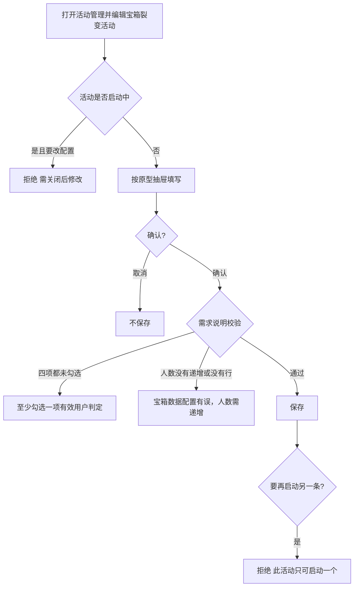
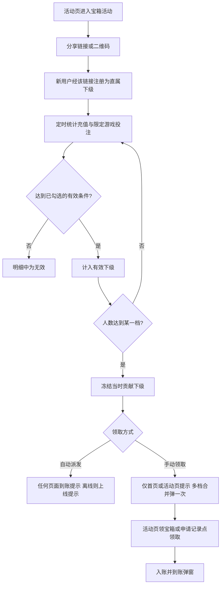

# 宝箱裂变活动 — 开发 / 测试宣讲需求

**文档类型：** 开发测试宣讲需求  
**日期：** 2026-10-30  

本文按 [`产品文档规范要求.md`](../../../docs/产品文档规范要求.md) 六段编写。

| 用哪份 | 用来做什么 |
|----|------|
| 本次需求说明 | 只采用其中的规则：谁能看见、怎样算有效、怎么发奖、启动后能不能改、数据怎么冻结。不按 Axure 画面另画一套后台。 |
| 可点原型 | 后台配置界面以 [活动管理](http://localhost:8787/admin/index.html#/activity) 为准。编辑列表中的「宝箱裂变活动」。365 管理后台同一抽屉，不另写一版界面。 |

`管理后台-开发测试宣讲需求.md` 里 **Locked 2026-10-30 宝箱裂变活动配置** 是该抽屉的锁定原文，不删。下文「展示规则」按这个原型写。「业务规则」按需求说明写。原型上还没有的校验，记在业务规则里，不改成第三套界面。

客户端页面、申请记录、下级明细、到账弹窗、宝箱裂变报表，不在上述活动管理地址里。这些只写需求说明中的规则，不补效果图。

---

## 一、需求背景与目标

### 1.1 背景

新增活动类型「宝箱裂变」。用户邀请其他玩家进入平台，被邀请人充值并在限定游戏里投注，邀请人按达标的有效下级人数获得对应奖励。

PC 首页的代理入口隐藏。H5 和 APP 侧边栏的代理入口隐藏。底栏换成转盘 icon。

活动时间由运营控制。活动展示在客户端活动页。宝箱可配置为达标后自动派发，或用户手动领取。奖励按需求说明都是真金。后台配置领取后需要的打码量倍数。

活动会限定游戏，运行期间可能调整游戏范围，活动数据需要定时统计：

- 已完成的用户不再按新的有效条件判断。
- 已派发的奖励不再收回。
- 未完成的用户，按新的有效条件重新判定是否有效。

### 1.2 路径 / 权限 / 联通

| 项 | 说明 |
|----|------|
| 后台原型 | `http://localhost:8787/admin/index.html#/activity`。点「宝箱裂变活动」进入编辑活动抽屉。活动类型为宝箱裂变活动。 |
| 前台 | 需求说明：入口在活动页，入口图由运营配置。本仓库没有单独的宝箱前台原型。 |
| 报表 | 需求说明：活动报表最下方新增「宝箱裂变报表」，翻页和刷新同金钱如雨活动报表。不在活动管理这个地址里配置。 |
| 谁能进 | 能编辑活动的运营可以保存。无活动管理权限的人不能保存。未登录用户不发奖、不累计。 |
| 联通 | 有效投注只统计活动允许游戏里勾选的游戏。都不勾选则不限制游戏。奖励进入账户。上级获得宝箱时，贡献下级的数据冻结入库。 |
| 资金 | 需求说明：奖励为真金。打码量倍数为 0 时不限流水。已派发的不收回。 |

### 1.3 目标

1. 运营在活动管理原型里配完一条宝箱裂变：开放人群、领取方式、有效用户、宝箱档位、活动说明。
2. 同一时间只能启动一个。启动期间不能改配置，关闭后才能改。到期自动关闭。
3. 条件或游戏范围变更后，已完成用户和已派发奖励保持不变，未完成用户按新条件重判。

### 1.4 业务要求

- 有效用户判定至少勾选 1 项，最多 4 项：累计充值、累计投注、累计充值次数、连续充值天数。
- 宝箱下一行有效人数必须高于上一行，至少保留一行。
- 此活动只可启动一个。启动期间所有配置不可修改。
- 明确不做：不按 Axure 改这个抽屉的排版；不把已派发奖励收回；不把已完成用户按新条件重判；不在本文写「已过期」的小时数（需求说明没有写何时过期）。

---

## 二、详细功能说明

### 2.1 活动管理里的配置界面

| 项 | 内容 |
|----|------|
| **功能名称** | 宝箱裂变活动配置 |
| **功能说明** | 在活动管理新增或编辑，活动类型为宝箱裂变活动时填写本活动。界面就是当前原型抽屉，不换成另一套表单。 |
| **展示规则** | 上卡与其他活动相同：活动标题、活动类型、选择标签。图标：移动端图标，说明「前端活动页面显示用」。越南项目没有 PC 端，不展示「PC端图标」，保存也不要求这张图。365 管理后台仍保留 PC 端图标。已上传时预览为红色活动标题。中卡：开放人群（「充值次数 >=」步进，后接「次的用户可看到此活动」）；领取方式（自动派发 / 手动领取）；提示页面限制（仅「仅在首页&活动页提示」一项）；有效用户判定，问号为「勾选的条件同时满足，才计入有效用户。未勾选的条件不判断。」四行勾选：累计充值 >=，占位「请输入充值金额」；累计投注 >=，占位「请输入投注金额」；累计充值次数 >=，占位「请输入次数」；连续充值天数 >=，占位「请输入天数」。中间是「活动允许游戏」，问号为「只统计这里选中的游戏。都不选，则不限制游戏。」黑按钮「选择游戏」，展开后为电子、真人、体育、棋牌、彩票、捕鱼。奖励重置倒计时(h) 为步进，右侧蓝色「重置倒计时剩余时间」。下卡：宝箱奖励配置，问号为「有效人数达到该档，发放对应奖励金额。打码量倍数为 0 时不限流水。」奖励类型下拉为真金、彩金；打码量倍数步进；表头为宝箱编号、有效人数、奖励金额，右上「+」，行尾删除。升级分享开关：是 / 否。开放的活动（多选），含每日签到、天天砸金蛋、天天好运金、月存好礼、每日签到循环等，不含宠物窝、奖上奖和宝箱裂变本身，vip 显示为「vip高额工资」。活动说明为工具栏加正文。页脚取消、确认。列表演示行活动 ID `1500277`，标题「宝箱裂变活动」。 |
| **交互逻辑** | 点新增或该行编辑打开同一抽屉。步进用减号、加号改数字。点「选择游戏」展开或收起游戏。点「+」在表底加一行。只剩一行时点删除，提示「至少保留一个宝箱」。点确认才保存。点取消不写。倒计时在抽屉打开后按秒减少，改小时数不改剩余时间。 |
| **业务规则** | 见 2.2。原型当前保存校验是：365 移动端和 PC 端图标都要有，越南只校验移动端图标；开放人群充值次数为大于等于 0 的数字；四个有效条件至少勾一个，勾了的必须是数字；重置倒计时至少 1 小时；打码量倍数大于等于 0；宝箱至少一行，编号和有效人数大于等于 1，奖励金额大于等于 0；升级分享为「是」时开放的活动至少选一个，选「否」时不展示也不校验；活动说明不能空。需求说明里更严的判断（不能为 0、次数和天数大于 1、人数必须递增、启动中不可改）原型还没有，按 2.2 验收，不因此改抽屉排版。 |
| **状态说明** | 领取方式：自动派发 / 手动领取。升级分享：是 / 否。奖励类型：真金 / 彩金。未选活动类型时仍是「请选择活动类型」。 |
| **延伸** | 与 365 管理后台这一抽屉保持同一套。越南项目不另写一份。唯一差别是越南宝箱表单没有 PC 端图标。 |

### 2.2 配置上的需求说明

| 项 | 内容 |
|----|------|
| **功能名称** | 宝箱裂变配置规则 |
| **功能说明** | 运营保存和修改时要遵守的规则。问号文案若原型已有，用原型上的句子；下面这些是需求说明里的提交规则。 |
| **展示规则** | 不新增字段。自动派发时，需求说明要求「获得宝箱提示页面限制」置灰；手动领取时该项可配。原型上该项固定为「仅在首页&活动页提示」，没有置灰。需求说明写所有奖励都是真金；原型下拉仍有彩金。两处同时保留，不把下拉改成只有真金，也不把需求说明改成可以发彩金。 |
| **交互逻辑** | 点确认时校验。不通过则不保存，并提示对应文案。活动已启动时，修改被拒绝，需先关闭。 |
| **业务规则** | 活动时间问号原文：「活动生效后，时间不可再编辑」。启用期间不能改时间，要先关闭。到期后活动状态自动关闭。打码量倍数必填，可为 0。问号原文：「活动领取奖金打码量倍数，设置为 0 时不限流水」。为 0 时不需要打码即可提款。领取方式问号原文：「手动领取是让用户在活动页手动操作领取」。提示页面问号原文：「获得宝箱时，只有用户停留在配置的页面时才会弹出提示」。自动派发时该项不参与，达标后任何页面即刻提示。有效用户问号原文：「条件需至少配置一个」。累计充值：自注册起的充值总金额，纯数字且不能为 0。累计投注：自注册起、统计游戏内的总投注，纯数字且不能为 0，游戏选择同轮盘；在本原型里就是「活动允许游戏」。累计充值次数：自注册起充值成功次数，纯数字且大于 1。连续充值天数：按自然日连续充值，纯数字且大于 1。四项都未勾选时提示「至少勾选一项有效用户判定」。这四项的勾选和数值，只在活动关闭或到期后可改。宝箱点添加时加在最下方。至少一行。下一行人数必须高于上一行，否则提示「宝箱数据配置有误，人数需递增」。此活动只可启动一个。启动期间所有配置不可修改，需关闭后修改。 |
| **状态说明** | 未启动 / 启动中 / 已关闭 / 到期自动关闭。启动中整张配置只读。 |
| **延伸** | 关闭后再改有效条件，见 2.5。 |

### 2.3 客户端入口与宝箱页规则

| 项 | 内容 |
|----|------|
| **功能名称** | 客户端宝箱活动 |
| **功能说明** | 需求说明里的前台规则。没有单独前台原型，不补页面稿。 |
| **展示规则** | 入口在活动页，入口图用后台配置的活动图片。PC 首页不展示代理入口。H5、APP 侧边栏不展示代理入口。底栏为转盘 icon。宝箱页四个区块：顶部条、分享区块、宝箱区块、活动规则。标题暂定「月入百万」。 |
| **交互逻辑** | 返回按原路返回。点「申请记录」打开记录弹窗。筛选：今天、昨天、过去 7 天、过去 15 天、过去 30 天。下滑加载更多，默认条数由效果图确认，本文不写死。点未领取的「领取」，奖励进入账户并弹出到账窗。分享：复制「我的链接」、复制邀请码（代理 ID）、点「点击保存」把二维码存到本地。社交工具按后台顺序从左到右，点击新开页面。明细筛选全部、有效的、无效的，选定后不用再确认。账户搜索为精准搜索。已达标未领取的宝箱，点击直接领取。 |
| **业务规则** | 申请记录列：时间、有效用户、奖励、状态、操作。时间格式 `yyyy-MM-dd HH:mm:ss`，是用户获得奖励的时间。有效用户是本笔奖励有多少受邀人达标。奖励格式 `R$ XX`。状态：已领取、未领取、已过期。未领取按发放时间由近及远，排在已领取前面。只有未领取有领取按钮。宝箱活动代理链接带独立标注，用来识别从本活动注册，类似轮盘活动代理链接。通过该链接注册的是代理的直属下级。每个用户代理编号不同，链接不同。二维码由前端按链接生成，边框留白。「直接下级数量」是通过此方式邀请到的人数。「有效下级 x 人」是已达标人数。明细里的用户都是经本活动链接注册的下级。充值是该下级自注册到现在的总充值。投注是该下级自注册到现在、在活动限定游戏中的总投注。有效用户说明的条件和参数来自后台，1 到 4 条，客户端按条数加高。宝箱展示需要的有效人数和奖励金额。三种效果：未达标；已达标未领取；已领取。未达标之间用未达标箭头。已达标未领取之间的箭头与已领取相同。最近一个未达标宝箱，和上一个已达标宝箱之间，也用已领取那套箭头。单数行从左到右，双数行从右到左，换行有箭头。个数以后台宝箱表为准。活动规则正文等于后台活动说明，换行一致。 |
| **状态说明** | 下级：有效 / 无效。宝箱：未达标 / 已达标未领取 / 已领取。记录：未领取 / 已领取 / 已过期。 |
| **延伸** | 提示弹窗见 2.4。 |

### 2.4 获得宝箱时的提示

| 项 | 内容 |
|----|------|
| **功能名称** | 宝箱提示 |
| **功能说明** | 告诉用户有宝箱可领，或奖励已经到账。 |
| **展示规则** | 需要手动领取时，弹出带「去开启」的提示。自动派发，或用户在活动页领取时，弹出到账金额。一次获得两个及以上宝箱，只弹一次，金额累计。 |
| **交互逻辑** | 用户在首页看到提示，点「开启」进入活动页，可领取宝箱保持强效果。从首页以外进入活动页，若有未领取宝箱，在活动页弹出；点「开启」只关闭弹窗，强效果还在。到账弹窗关闭不需要读秒。 |
| **业务规则** | 手动领取的弹出页面由后台提示页面限制控制。需求说明写只在首页、活动页弹出。用户不在线，上线后再提示，该弹窗在最下层。自动派发不看页面限制，达标后任何页面即刻弹出；不在线则上线提示。提示失败不改变是否已经入账。同一档不因申请记录和点宝箱各发一次。 |
| **状态说明** | 待提示 / 已弹出 / 已关闭。有未领取宝箱时强效果持续，直到领完或过期。 |
| **延伸** | 过期时间点需求说明未写。 |

### 2.5 定时统计与冻结

| 项 | 内容 |
|----|------|
| **功能名称** | 活动数据定时统计 |
| **功能说明** | 游戏范围和有效条件可能变化，已完成和未完成要分开。 |
| **展示规则** | 客户端明细的充值、投注算到查询当时。报表里点开的贡献名单，是上级获得该宝箱时的冻结数。 |
| **交互逻辑** | 定时任务只重算未完成用户。已完成用户跳过。已派发奖励不写收回。上级获得宝箱时，把当时的直属下级贡献入库，之后不再累计。 |
| **业务规则** | 已完成的用户不再按新的有效条件判断。已派发的奖励不再被收回。未完成的用户按新的有效条件重新判定是否有效。 |
| **状态说明** | 未完成：可被新条件改判。已完成：条件锁定。已派发：金额锁定。 |
| **延伸** | 客户端「有效下级 x 人」可以随统计变化。已经发给上级的那一档人数和金额不跟着变。 |

### 2.6 宝箱裂变报表

| 项 | 内容 |
|----|------|
| **功能名称** | 宝箱裂变报表 |
| **功能说明** | 查看发放和领取。规则来自需求说明。页面翻页、刷新同金钱如雨活动报表。 |
| **展示规则** | 汇总：总奖励人数、总有效用户数量、总奖励金额、已领取奖励金额。需求说明标题曾写作「总奖励奖励」，按「总奖励金额」执行。列表是获得奖励的用户。有效用户数为蓝色下划线，可点击。弹窗列出这笔奖励由哪些直属下级贡献，并显示有效充值金额（总充值）、有效充值次数（成功次数）、最大连续充值天数、有效投注金额（限定游戏内的总投注）。原型未画翻页，但要有翻页。 |
| **交互逻辑** | 奖励额度填最小和最大，两端都包含。领取状态单选：全部、已领取、未领取、已过期。点有效用户数打开冻结明细。 |
| **业务规则** | 总奖励人数含已获得但未领取。总有效用户数量是有效直属下级总数。总奖励金额是活动发放总额。已领取奖励金额是用户已经领取的总额。弹窗数据在获得宝箱时冻结，之后下级再充值、再投注，不改这笔明细。报表不能收回历史奖励。 |
| **状态说明** | 全部 / 已领取 / 未领取 / 已过期。无记录时列表为空。 |
| **延伸** | 不在报表里改活动配置。 |

---

## 三、流程图 / 交互说明

### 3.1 运营在活动管理里保存

入口：[活动管理](http://localhost:8787/admin/index.html#/activity) → 编辑「宝箱裂变活动」→ 确认或取消。

### 3.2 用户侧

校验失败留在抽屉。取消回到列表且不写入。客户端返回按原路回到进入前的页面。

---

## 四、异常场景

| 异常场景 | 触发条件 | 用户感知 | 系统处理 | 是否可重试 | 备注 |
|---|---|---|---|---|---|
| 接口失败 / 超时 | 保存、领取、报表查询失败或超时 | 配置不成功或领取不到账 | 不写入半套配置，不重复入账 | 可重试 | 以是否已入账判断，避免补点双发 |
| 空数据 / 无记录 | 没有申请记录、没有下级、报表没有发放 | 空列表 | 不出现领取按钮 | 有数据后出现 | 默认条数不写死 |
| 未登录 | 未登录打开宝箱页或点领取 | 看不到自己的链接和奖励 | 不发奖、不累计 | 登录后可重试 | |
| 无权限 | 无活动管理权限 | 不能保存 | 拒绝 | 否 | |
| 重复提交 | 连点确认、连点领取、连点启动 | 配置只写一次；奖励只入账一次 | 第二条活动不能启动 | 否 | 已派发不能靠重试收回 |
| 图片 / 资源加载失败 | 活动图标或二维码失败 | 预览或二维码空白 | 不算已上传；保存二维码可再点 | 可重试 | 二维码须留白 |
| 页面加载失败 | 活动管理或宝箱页打不开 | 看不到内容 | 不发奖 | 可刷新 | |
| 第三方降级 | 分享站点打不开；统计延迟 | 新开页失败；人数暂时不更新 | 不把未完成判成已完成 | 恢复后只重算未完成用户 | 已完成和已派发不改 |
| 启动中修改 | 活动启用时改任意配置 | 不能保存 | 拒绝，需先关闭 | 关闭或到期后可改 | |
| 再启动一条 | 已有一条启动中 | 不能再启动 | 拒绝 | 先关闭原活动 | 只可启动一个 |
| 有效条件都未勾选 | 四个条件都没选 | 提示「至少勾选一项有效用户判定」 | 不保存 | 勾选后可再提交 | |
| 条件数值非法 | 累计充值或累计投注为 0 或不是纯数字；次数或天数不大于 1 | 不能保存 | 不保存 | 改成合法数字后可提交 | 原型当前只校验「是数字」 |
| 宝箱人数不递增 | 下一行人数不高于上一行，或没有行 | 提示「宝箱数据配置有误，人数需递增」 | 不保存 | 改人数后可提交 | 原型当前只校验每行人数大于等于 1，并提示「至少保留一个宝箱」 |
| 活动到期 | 到了结束时间 | 活动页无入口 | 状态自动关闭，不再新发 | 关闭后可再改再启动 | |
| 条件变更 | 关闭后改了条件或游戏再启动 | 已完成结果不变 | 已派发不收回；未完成按新条件重判 | 不适用收回 | |
| 用户不在线 | 达标时离线 | 上线后才看到提示 | 手动弹窗在最下层 | 上线即提示 | 到账弹窗关闭不读秒 |
| 多个宝箱同时达标 | 一次统计跨过两档及以上 | 只弹一次，金额累加 | 各档仍分别记账 | 否 | |

---

## 五、验收标准

### 功能

- [ ] 活动类型为宝箱裂变。PC 首页代理入口隐藏。H5、APP 侧边栏代理入口隐藏。底栏为转盘 icon。
- [ ] 只可启动一个。启动期间不能改配置。到期自动关闭。
- [ ] 需求说明：奖励为真金。打码量倍数可为 0，0 表示不限流水。
- [ ] 四个有效条件至少勾一个、最多四个。都未勾选时提示「至少勾选一项有效用户判定」。
- [ ] 累计充值、累计投注为纯数字且不能为 0。次数、天数为纯数字且大于 1。连续天数按自然日。投注只统计活动允许游戏；都不选则不限制。
- [ ] 宝箱至少一行，下一行人数必须高于上一行，否则提示「宝箱数据配置有误，人数需递增」。
- [ ] 已完成用户不按新条件重判。已派发不收回。未完成用户按新条件重判。获得宝箱时贡献下级冻结。

### 页面

- [ ] 打开 `http://localhost:8787/admin/index.html#/activity`，编辑「宝箱裂变活动」，抽屉字段与 2.1 一致。
- [ ] 申请记录、明细、宝箱三种样式、报表汇总和蓝色有效用户数，按 2.3、2.6 的列和文案验收。不要求活动管理抽屉里出现这些弹窗。

### 交互

- [ ] 抽屉里取消不保存，确认才写入。选择游戏可展开。宝箱可加行。只剩一行不能删掉。
- [ ] 客户端返回按原路。链接和邀请码可复制。二维码可保存且留白。社交工具新开页面。
- [ ] 未领取记录和已达标未领取宝箱可以领取，领取后入账。多个宝箱同时获得只弹一次。到账弹窗关闭不读秒。

### 数据

- [ ] 充值、投注从下级注册时算起。投注只含限定游戏。直接下级只含通过宝箱链接注册的用户。
- [ ] 总奖励人数含未领取。奖励额度筛选包含最小和最大。未领取排在已领取前面。
- [ ] 同一档不会入账两次。报表弹窗不随下级后来的充值、投注变化。

### 异常

- [ ] 第四节每一条的提示、是否入账、可否重试与表一致。

### 兼容

- [ ] 后台配置在桌面浏览器可打开上述活动管理地址并保存。
- [ ] 客户端规则适用于 PC、H5、APP 的入口差异。本仓库不另做前台页。

### 性能

- [ ] 统计延迟时，不把未完成用户提前标成已完成，也不重复派发已派发档位。
- [ ] 连点确认、连点领取不产生第二条启动中的活动或第二笔奖励。

### 埋点

- [ ] 需求说明不要求埋点。

---

## 六、风险预估

### 6.1 已发奖励被收回，或已完成用户被改判

- **是什么：** 定时统计把已完成、已派发也做了全量重算。
- **影响：** 已入账真金被扣回，或已达标下级被移出，用户看到的奖励对不上。
- **出问题后怎么处理：** 用冻结的那一版人数和金额对账，把被扣回的真金补回。暂停重算。
- **有没有降级：** 有。重算只扫未完成用户。已派发记录没有收回操作。

### 6.2 同时启动两条，或启动中仍能改配置

- **是什么：** 「只可启动一个」和「启动期间不可修改」在保存时没有生效。
- **影响：** 同一下级被算进两套宝箱，真金重复出账；或进行中改了游戏范围，未完成用户突然达标。
- **出问题后怎么处理：** 关闭多出来的那条。多发部分先冻结，由人工对账。进行中的修改作废，恢复启动时的配置。
- **有没有降级：** 有。保存和启动以「是否已有启动中」为准，不以前端按钮是否可点为准。

### 6.3 原型校验和需求说明不一致，该拦的配置被保存

- **是什么：** 原型现在允许人数不递增、允许累计充值为 0、奖励类型可选彩金，需求说明要求拦截或只发真金。
- **影响：** 按原型保存的活动，发奖人数顺序错，或真金打成彩金。
- **出问题后怎么处理：** 已保存的活动先停止发放。人数不递增的不发奖。奖励类型不是真金的暂停并告警，不对用户自动改钱包。
- **有没有降级：** 有。发放前再查一次人数递增和奖励类型。不满足则不发，不改抽屉排版。

### 6.4 实时明细和冻结明细被当成同一份数

- **是什么：** 报表弹窗在发奖后仍随下级充值、投注增加。
- **影响：** 「这笔宝箱由谁贡献」和发奖当时不一致，无法对账。
- **出问题后怎么处理：** 用获得宝箱时的入库快照覆盖弹窗。客户端明细仍可显示到查询当时。
- **有没有降级：** 有。报表弹窗只读冻结数据。

### 6.5 提示打在错误页面，或离线用户上线没有提示

- **是什么：** 自动派发仍被页面限制挡住；或离线达标没有进入上线提示。
- **影响：** 用户不知道真金已到账，或手动领取的提醒丢失，奖励放着直到过期。
- **出问题后怎么处理：** 自动派发改为不看页面限制，上线后补提示。已入账的不重复入账。未领取保持未领取。
- **有没有降级：** 有。提示失败不影响入账。用户仍能在申请记录里领取未领取的奖励。
