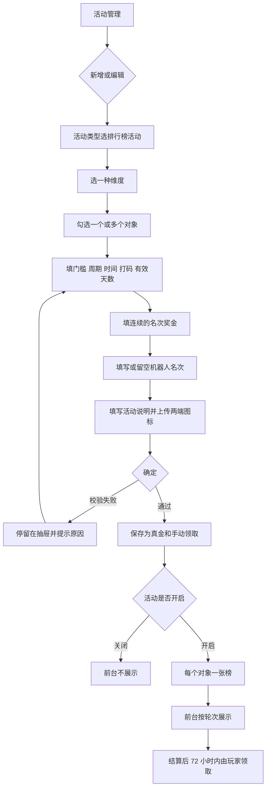

# 排行榜活动 — 后台需求说明

**文档类型：** 开发 / 测试需求  
**日期：** 2026-11-07  
**范围：** Juan365 管理后台，活动类型「排行榜活动」  
**不含：** 原型截图、前台页面稿。前台领取和展示见 `365-frontend-prototype/docs/排行榜活动-前台需求说明.md`。

本文只写后台要配置什么、保存什么、校验什么。走查用的账号和金额是配置示例，不能当作正式对账口径。

---

## 一、需求背景与目标

### 1.1 背景

365 要加一种排行榜活动。玩家按有效投注额比名次，每个名次发一笔固定真金。投注额只决定名次，不按玩家打码量占奖池的比例分钱。

一张活动只选一种榜单维度：游戏类型、游戏厂商、单独子游戏。同一张活动里勾选多个对象时，每个对象各出一张榜，共用同一张名次奖金表，分开排名、分开到账。

运营还要能指定哪些名次由机器人占住。例如占住第 1、2、3 名，成绩最好的真实玩家就显示成第 4 名，并且只能领第 4 名的固定奖金。

### 1.2 路径 / 权限 / 联通

| 项 | 说明 |
|----|------|
| 后台入口 | 活动管理 → 新增 / 编辑活动。活动类型选「排行榜活动」后，编辑抽屉出现本活动的填写项。 |
| 谁能进 | 能进入活动管理并编辑活动的运营可以新增、编辑、开启、关闭、开关浮标。没有活动管理权限的人不能打开编辑抽屉，也不能保存。 |
| 谁不能进 | 前台会员不能进入本页。本配置不出现在体育管理后台、体育风控后台、U8 棋牌后台、越南后台、活动平台。 |
| 联通 | 保存后的活动配置下发给 365 前台榜单页。前台按活动、维度、对象、轮次展示和领取。后台不直接给会员入账。 |
| 浮标 | 「排行榜活动」可以开浮标，沿用活动列表上的浮标开关。 |
| 其他活动 | 宝箱裂变等其他活动自己的领取方式和奖励类型不动。本活动不能改出「自动领取」或「彩金」。 |

### 1.3 目标

1. 运营能新建并保存一张排行榜活动：维度、统计范围、门槛、周期、时间、名次奖金、机器人名次、活动说明。
2. 保存结果里奖励类型固定为真金，领取方式固定为手动领取。
3. 勾选多个对象时，前台能拆成多张榜，奖金表相同，名次和到账彼此独立。
4. 机器人占位名次保存后，真实玩家只能领自己显示名次的固定奖金。

### 1.4 业务要求

硬约束：

| 事项 | 执行 |
|------|------|
| 一张活动几种维度 | 只选一种。游戏类型、游戏厂商、单独子游戏要分开建活动。 |
| 排名依据 | 只按有效投注额从高到低。作废、取消的注单不计入。 |
| 奖金 | 每个名次一笔固定金额。不按投注额占奖池比例分配。 |
| 奖励类型 | 写死真金，进入真金钱包。没有彩金选项。 |
| 领取 | 写死手动领取。轮次结算后 72 小时内，玩家在前台榜单页领取。逾期失效。没有自动到账。 |
| 时区 | 自然日、自然周都按 GMT+8。 |
| 刷新 | 榜单每 10 分钟刷新一次。 |
| 并列 | 有效投注额相同，先达到该金额的排前面。 |
| 发奖范围 | 名次奖金表最后一行的「名次止」，就是这张榜发奖到第几名。 |

明确不做：

- 不做按打码量入池、再按占比分奖池。
- 不做自动派发、不做次日 14:00 前到账。
- 不在本活动提供彩金。
- 不在前台把机器人名次标成「机器人」。后台可以写「机器人占位名次」，前台只显示成普通账号。
- 不把走查示例里的金额、账号写成可对账的正式账单。

---

## 二、详细功能说明

### 2.1 活动类型与列表

1. **功能名称：** 活动类型「排行榜活动」
2. **功能说明：** 在现有活动管理里增加一种活动类型。列表、开启关闭、浮标、排序、标签沿用活动管理已有能力。
3. **展示规则：** 类型下拉出现「排行榜活动」，位置在「抽奖活动」之后、「视频完播奖励」之前。列表能按类型筛出这类活动。开启中的活动前台才展示。
4. **交互逻辑：** 运营点新增或编辑，类型选「排行榜活动」，抽屉中部换成排行榜表单。点确定时先做本活动校验，通过后保存。点取消关闭抽屉，不保存。
5. **业务规则：** 活动名称、标签、排序、状态、浮标使用活动管理原字段。排行榜自己的开始、结束时间同时作为这条活动的起止时间。状态关闭后，前台不再展示这张活动拆出的榜。
6. **状态说明：** 关闭：前台不展示。开启：前台按配置展示。浮标开：大厅可出浮标。浮标关：只从活动入口进。
7. **延伸：** 浮标点击后进入前台榜单页，落到这张活动对应的维度。

### 2.2 榜单维度与统计范围

1. **功能名称：** 榜单维度、统计范围
2. **功能说明：** 决定这张活动比的是哪一类对象。勾选几个对象，就拆几张榜。
3. **展示规则：** 维度是必填单选：游戏类型、游戏厂商、单独子游戏。统计范围按当前维度列出可勾选项，可搜索。游戏类型下的说明是「勾选的每个游戏类型各一张榜」。厂商、子游戏换成对应文案。下面固定一行：「多张榜共用下面的名次奖金，分开排名、分开到账。」
4. **交互逻辑：** 切换维度时，已勾选的对象清空，列表换成该维度的对象。搜索只过滤当前列表，不改变已勾选结果。未勾选任何对象时不能保存。
5. **业务规则：** 一张活动不能同时选两种维度。同一对象不要靠一张活动配两次；要两套奖金就建两张活动。有效投注只统计该榜勾选范围内的注单。
6. **状态说明：** 默认维度是游戏类型，统计范围为空。搜索无命中时，该维度下列表为空，已勾选如果被滤掉仍保留，只是当前看不见。
7. **延伸：** 前台把同一维度下的多张榜放进同一个页签组，用对象名称切换。

### 2.3 统计指标与奖励方式

1. **功能名称：** 统计指标、奖励方式
2. **功能说明：** 告诉运营这张榜怎么排名、怎么发钱。这两项不能改成别的算法。
3. **展示规则：** 统计指标是置灰输入框，值固定「有效投注额」。问号：「只按有效投注额从高到低排名。打码量不参与分奖。」奖励方式是置灰输入框，值固定「固定名次奖金」。补充文案：「跟 Playtime 一样：名次对应固定金额。打码量只决定名次，不按入池比例分钱。」
4. **交互逻辑：** 两项都不可编辑，保存时也不读取运营输入。
5. **业务规则：** 排名只看本榜范围内的有效投注额。金额高的在前。金额相同，先达到的在前。奖金不随投注额放大或缩小。
6. **状态说明：** 始终为上述两个固定值。没有第二选项。
7. **延伸：** 打码量倍数只作用于领到的真金，不参与排名。

### 2.4 上榜门槛、统计周期、活动时间

1. **功能名称：** 上榜最低有效投注、统计周期、活动开始、活动结束
2. **功能说明：** 决定谁有资格上榜，以及一张活动里怎么切轮次。
3. **展示规则：** 门槛、周期、开始、结束都是必填。周期三选一：每日、每周、活动期内。周期下方说明：活动时间内按所选周期切轮次；前台标题显示第 1 名奖金；倒计时到本轮结束；榜单每 10 分钟刷新；投注额相同，先达到的排前。
4. **交互逻辑：** 选周期只改变轮次切法，不改奖金表。开始、结束按 `YYYY-MM-DD HH:mm:ss` 手填。确定时校验格式和先后。
5. **业务规则：**
   - 门槛大于等于 0，最大 9999999。0 表示不设门槛。默认 100。本轮有效投注达到门槛才有资格。
   - 每日：GMT+8 自然日 00:00:00 至 23:59:59，次日结算。
   - 每周：周一 00:00:00 至周日 23:59:59，下周一结算。
   - 活动期内：整个活动时间只结算一次，活动结束后结算。
   - 三种周期都是结算后 72 小时内手动领取。
   - 开始时间必须早于结束时间。
6. **状态说明：** 活动未开始：前台不按进行中展示。活动进行中：当前轮次进行中，只显示预估奖金。轮次已结算且未过 72 小时：前台可领取。超过 72 小时：该轮奖金失效。活动结束：不再开新轮次。
7. **延伸：** 每日榜前台提供「今日 / 昨日」。每周榜提供「本周 / 上周」。活动期内不切昨日或上周。

### 2.5 奖励类型、打码量倍数、奖金有效天数、领取方式

1. **功能名称：** 真金、打码、有效天数、手动领取
2. **功能说明：** 规定领到手里的是什么钱、提现前要完成多少流水、多久内必须领。
3. **展示规则：** 奖励类型是置灰输入框，值「真金」。问号：「365 只发真金，奖励进入真金钱包。」打码量倍数、奖金有效天数是必填数字。领取方式是置灰输入框，值「手动领取」。补充文案：「结算后 72 小时内领取，逾期失效。」问号：「结算后 72 小时内，玩家在前台榜单页领取自己名次的固定奖金。机器人占位名次不能领取。」
4. **交互逻辑：** 奖励类型和领取方式不能切换。打码量倍数、有效天数可改。保存时强制写成真金、手动领取，不接受其他值。
5. **业务规则：**
   - 奖金进入真金钱包，不进彩金。
   - 打码量倍数 0 到 999。0 表示不限流水，领到后不因本奖金再要求打码。大于 0 时，提现前需完成「奖金 × 倍数」的打码。
   - 奖金有效天数是 1 到 365 的整数，默认 30。从到账当天起算。有效期内没有完成打码，这笔奖金不能提现。
   - 领取窗口固定 72 小时，从该轮结算时点起算，不能改成自动到账。
6. **状态说明：** 未结算：不可领。结算后 72 小时内未领：可领。已领：不可再领。逾期未领：失效，金额不再发放。
7. **延伸：** 其他活动类型仍可保留自己的自动派发或彩金。那些控件不能出现在排行榜表单里。

### 2.6 名次固定奖金

1. **功能名称：** 名次固定奖金表
2. **功能说明：** 配置从第 1 名发到第几名，每一档发多少真金。
3. **展示规则：** 表头为名次起、名次止、获奖人数、固定奖金、删除。表上方说明：「奖金是该名次的固定金额，不是奖池分成。名次从 1 开始，下一行起点必须等于上一行终点 + 1。获奖人数 = 名次止 − 名次起 + 1，同一档金额相同。最后一行的终点就是前台发奖到第几名。」表下有「+ 新增名次」。
4. **交互逻辑：** 改名次起或名次止，获奖人数立刻重算。新增一行时，名次起和名次止都等于上一行名次止 + 1，金额为空。只剩一行时点删除，提示「至少保留一条名次奖金」，不删除。
5. **业务规则：**
   - 至少一行。
   - 名次起、名次止必须是大于 0 的整数。名次起不能大于名次止。
   - 第一行名次起必须是 1。
   - 下一行名次起必须等于上一行名次止 + 1。不能重叠，不能留空。
   - 固定奖金不少于 0，最多两位小数，不能大于 9999999。
   - 同一档里每个名次的金额相同。
   - 名次超出最后一行名次止的玩家，不发奖。
6. **状态说明：** 获奖人数算不出来时显示「–」，该行不能保存。金额为空或格式不对时，确定失败并指出第几行。
7. **延伸：** 新建活动的默认奖金表示例是：第 1 名 8000.00、第 2 名 5000.00、第 3 名 3000.00、第 4–10 名 350.00、第 11–20 名 150.00。运营可以改。这组数字只是默认值，不是正式奖池。

### 2.7 机器人占位名次

1. **功能名称：** 机器人占位名次
2. **功能说明：** 运营指定哪些名次不给真实玩家。这些名次在前台看起来仍是普通掩码账号。
3. **展示规则：** 字段不是必填。占位提示「1,2,3」。输入时下方即时提示。留空时提示：「留空时，第 1 名起都是真实玩家，按自己的名次领取固定奖金。」格式不对时提示：「格式示例：1,2,3 、123 或 1-3。大于 9 的名次请用逗号，例如 1,2,10。」格式正确时提示占住了哪些名次，以及真实玩家第一个可领名次是第几名。
4. **交互逻辑：** 运营输入后不用点别处，提示就更新。点确定时再校验一次。超过发奖最后一名不能保存。
5. **业务规则：**
   - 留空：全部名次都是真实玩家。
   - 接受英文逗号、中文逗号。空格去掉后再解析。
   - `1,2,3` 表示第 1、2、3 名。
   - `1-3` 表示第 1 名到第 3 名。区间终点不能小于起点，终点减起点不能大于 99。
   - 连续 3 位及以上、且每位都是 1 到 9 的数字，按逐位拆开。`123` 等于第 1、2、3 名。
   - 不是这种逐位写法时，按一个名次理解。`12` 是第 12 名，不是第 1 名和第 2 名。第 10 名及以后要用逗号，例如 `1,2,10`。
   - 重复名次不能保存。
   - 名次必须是大于 0 的整数，且不能大于奖金表最后的名次止。
   - 真实玩家只在自己内部按有效投注排序，再填进没被机器人占住的名次。
   - 真实玩家只能领取自己显示名次的固定奖金，不能领取机器人名次的奖金。
   - 示例：占住 1、2、3。奖金表第 4–10 名是 350。成绩最好的真实玩家显示第 4 名，领取 350，不能领取第 1 名的金额。
6. **状态说明：** 留空是合法状态。格式错误不能保存。名次超出发奖范围不能保存。
7. **延伸：** 前台不出现「机器人」三个字。机器人行要有头像、掩码账号和一段用于把榜排顺的展示投注额。这段展示投注额不入账、不发奖、不进会员流水。

### 2.8 活动说明与保存

1. **功能名称：** 活动说明、确定保存
2. **功能说明：** 活动说明展示在前台规则区。确定时把整张表单校验完再保存。
3. **展示规则：** 活动说明必填，最多 500 字。移动端图标、PC 端图标沿用活动编辑里的上传位，两张都必填。
4. **交互逻辑：** 点确定，按下面顺序检查。任一项失败就停在抽屉里，用原有错误提示说出原因，不保存。全部通过后关闭抽屉，列表出现或更新这条活动。
5. **业务规则：** 保存字段至少包括：维度、对象列表、门槛、周期、开始、结束、奖励类型「真金」、打码量倍数、奖金有效天数、领取方式「手动领取」、奖金行、机器人名次数组、活动说明、两端图标。领取方式和奖励类型即使用户改了页面，落库仍是手动领取和真金。
6. **状态说明：** 未通过校验：数据不变。通过：新活动进入列表；编辑则覆盖原配置。已经发出的历史轮次奖金不因事后改表而追回。
7. **延伸：** 进行中的轮次只展示预估。改配置后的新轮次按新表执行。已结算未领取的轮次，按结算当时的名次和金额领取。

校验失败时的提示：

| 条件 | 提示 |
|------|------|
| 未上传移动端图标 | 请上传移动端图标 |
| 未上传 PC 端图标 | 请上传PC端图标 |
| 未选统计范围 | 请选择统计范围 |
| 门槛为空、不是数字或小于 0 | 请输入上榜最低有效投注 |
| 开始或结束不是 `YYYY-MM-DD HH:mm:ss` | 请输入活动开始时间或结束时间，并带上格式 |
| 开始不早于结束 | 活动开始时间必须早于结束时间 |
| 打码量倍数为空、不是数字或小于 0 | 请输入打码量倍数 |
| 有效天数不是 1 到 365 的整数 | 奖金有效天数须为 1 到 365 的整数 |
| 没有奖金行 | 请至少配置一条名次奖金 |
| 名次不是整数、小于 1、起点大于终点 | 指出第几行 |
| 第一行不是从第 1 名开始 | 名次必须从第 1 名开始 |
| 名次重叠或中间断开 | 名次必须连续，不能重叠或留空 |
| 金额不是不少于 0 且最多两位小数 | 指出第几行固定奖金 |
| 金额大于 9999999 | 指出第几行固定奖金不能大于 9999999 |
| 机器人格式不对 | 机器人占位名次格式不正确，示例 1,2,3 |
| 机器人名次超过最后一名 | 机器人名次不能超过榜单最后一名 |
| 活动说明为空 | 请输入活动说明 |
| 只剩一行还点删除 | 至少保留一条名次奖金 |

### 2.9 配置示例

下面三张是后台里已经配好的示例，用来走查前台三种维度。金额和账号只供走查，不是正式账单。

| 活动 | 维度 | 对象 | 周期 | 时间 | 机器人 | 奖金 |
|------|------|------|------|------|--------|------|
| 电子与真人周榜 | 游戏类型 | Slot、Casino | 每周 | 2026-11-02 00:00:00 至 2026-11-08 23:59:59 | 1,2,3 | 1 名 8000、2 名 5000、3 名 3000、4–10 名 350、11–20 名 150 |
| JILI 厂商日榜 | 游戏厂商 | JILI | 每日 | 2026-11-01 00:00:00 至 2026-11-30 23:59:59 | 无 | 1 名 3000、2 名 2000、3 名 1500、4–10 名 200 |
| Wild Bounty 子游戏榜 | 单独子游戏 | Wild Bounty Showdown | 活动期内 | 2026-11-01 00:00:00 至 2026-11-30 23:59:59 | 无 | 1 名 8000、2 名 4000、3 名 2000、4–10 名 500 |

三张活动的门槛都是 100，打码量倍数都是 1，奖金有效天数都是 30，奖励类型都是真金，领取方式都是手动领取。周榜的活动说明要写明第 1、2、3 名由机器人占位，以及真实玩家只能领自己显示名次。另外两张说明有效投注只统计本榜范围、固定奖金、10 分钟刷新、相同投注额先到先排、72 小时内手动领取。

---

## 三、流程图 / 交互说明

改维度会清空已选对象，再回到「勾选对象」。删除奖金行若只剩一行，停在表格并提示，不关闭抽屉。

---

## 四、异常场景

| 异常场景 | 触发条件 | 用户感知 | 系统处理 | 是否可重试 | 备注 |
|----------|----------|----------|----------|------------|------|
| 接口失败 / 超时 | 保存活动时接口失败或超时 | 抽屉不关闭，提示保存失败 | 不写入新配置，原活动保持原样 | 可 | 运营可再次点确定 |
| 空数据 / 无记录 | 统计范围搜索不到对象，或奖金表被删到不能再删 | 列表为空，或提示至少保留一条 | 不把空范围保存成一张榜 | 可 | 没勾选对象不能保存 |
| 未登录 | 后台登录态失效 | 不能继续保存 | 回到后台登录，当前未保存内容不落库 | 可 | 重新登录后要重新打开编辑 |
| 无权限 | 账号没有活动管理编辑权限 | 看不到编辑入口，或确定后提示无权限 | 不保存 | 否 | 换有权限的账号 |
| 重复提交 | 确定被连续点多次 | 只出现一条活动，或编辑只更新一次 | 同一次编辑只保存一份配置 | 否 | 保存过程中按钮不可重复生效 |
| 图片 / 资源加载失败 | 图标上传失败，或已上传图标打不开 | 对应上传位不算完成 | 按未上传拦截，提示上传对应端图标 | 可 | 移动端和 PC 端各自检查 |
| 页面加载失败 | 活动管理或编辑抽屉打不开 | 页面失败提示 | 不使用半份表单保存 | 可 | 刷新后重新进入 |
| 第三方降级 | 本配置不依赖第三方发奖 | 无 | 不适用。发奖发生在前台领取真金 | 不适用 | 后台只保存规则 |
| 校验不通过 | 时间、名次、金额、机器人格式不合法 | 看到第二节的对应提示 | 不保存 | 可 | 改完再确定 |
| 进行中改奖金 | 当前轮次还没结算就改了奖金表 | 当前轮次仍按旧表显示预估 | 新轮次才用新表。已结算未领的按结算当时的表 | 不适用 | 已入账的真金不追回 |
| 活动关闭 | 运营把状态关掉 | 前台入口不再展示这张活动 | 已领取的真金保留。未领取且仍在 72 小时内的，按前台规则处理为不可再从关闭活动进入领取 | 可 | 重新开启不补发已逾期的轮次 |

---

## 五、验收标准

### 功能

- [ ] 活动类型中有「排行榜活动」，位置在抽奖活动之后。
- [ ] 一张活动只能选一种维度。切换维度会清空已选对象。
- [ ] 勾选多个对象时，保存结果表示多张榜共用一张奖金表，分开排名、分开到账。
- [ ] 统计指标固定有效投注额，奖励方式固定名次奖金，两项都不能改。
- [ ] 奖励类型保存结果是真金，表单上没有彩金。
- [ ] 领取方式保存结果是手动领取，表单上没有自动领取。
- [ ] 每日、每周、活动期内三种周期的结算时点与 72 小时领取窗口符合 2.4。
- [ ] 奖金表必须从第 1 名连续排到最后一名，获奖人数等于名次止减名次起再加 1。
- [ ] `1,2,3`、`123`、`1-3` 都表示占住第 1、2、3 名。`12` 只表示第 12 名。
- [ ] 机器人名次超过最后一名、重复、格式错误都不能保存。
- [ ] 留空机器人名次可以保存，第 1 名起都是真实玩家。
- [ ] 宝箱等其他活动的自动派发和彩金选项仍在，不受本活动影响。

### 页面

- [ ] 编辑抽屉里能看到维度、范围、门槛、周期、时间、真金、打码倍数、有效天数、手动领取、奖金表、机器人名次、活动说明。
- [ ] 置灰项不能输入。必填项有必填标识。
- [ ] 获奖人数随名次起止变化。

### 交互

- [ ] 确定失败时抽屉不关，并出现对应提示。
- [ ] 只剩一行奖金时不能删除。
- [ ] 新增名次行的起点等于上一行终点加 1。
- [ ] 取消不保存。

### 数据

- [ ] 门槛 0 表示无门槛。打码倍数 0 表示不限流水。
- [ ] 金额最多两位小数，上限 9999999。
- [ ] 有效天数只接受 1 到 365 的整数。
- [ ] 相同有效投注额时，先达到的名次更靠前。这条规则写入活动说明和下发给前台的规则。

### 异常

- [ ] 第四节每一行的处理都能在保存失败、无权限、重复确定、图标失败时复现。

### 兼容

- [ ] 后台编辑抽屉在现有管理后台宽度下，名次表和机器人输入框可以看全并完成保存。

### 性能

- [ ] 连续点确定只产生一次保存结果。
- [ ] 名次起止变化时，获奖人数在当次输入后更新，不需要重新打开抽屉。

### 埋点

本需求不要求埋点。

---

## 六、风险预估

### 6.1 真实玩家领走机器人名次的奖金

1. **是什么：** 机器人占住第 1、2、3 名后，成绩最好的真实玩家仍按第 1 名的金额发奖。
2. **影响：** 多发真金。占位名次越高，差额越大。
3. **出问题后怎么处理：** 暂停该活动新轮次发奖，按结算当时的显示名次核对已发金额，多发部分冻结提现并人工冲正。未领取的改按显示名次发放。
4. **有没有降级：** 有。可先把机器人名次清空，使全部名次回到真实玩家，再恢复领取。已多发的钱不自动扣回，走人工冲正。

### 6.2 同一笔奖金发放两次

1. **是什么：** 玩家或接口重试导致同一轮次、同一张榜入账两次。
2. **影响：** 真金多发，并可被提现。
3. **出问题后怎么处理：** 同一会员、同一活动、同一对象、同一轮次只允许一条领取成功记录。第二次直接返回已领取，不再加钱。已多发的冻结提现并冲正。
4. **有没有降级：** 有。领取接口以这条唯一记录为准。记录写成功之前不加真金余额。

### 6.3 按奖池比例分钱

1. **是什么：** 实现时把有效投注额加总后按占比发奖，而不是按名次发固定金额。
2. **影响：** 玩家到手金额和后台配置不一致，可能超出或低于配置。
3. **出问题后怎么处理：** 停止该轮继续领取，已发金额与该名次固定奖金核对，差额人工处理。
4. **有没有降级：** 有。发奖只读取该显示名次所在档的固定金额。投注额只参与排序。

### 6.4 结算后仍按自动到账或彩金入账

1. **是什么：** 轮次结束时系统自动把奖金打进彩金，或在 14:00 前自动到账。
2. **影响：** 资金科目错误，玩家没有手动领取记录，过期失效规则失效。
3. **出问题后怎么处理：** 关闭自动任务。已自动入账的改为已领取状态，避免再领一次。科目错的调整到真金。
4. **有没有降级：** 有。排行榜配置不提供自动领取和彩金，保存时强制写回手动领取和真金。

### 6.5 改表影响已经结算的轮次

1. **是什么：** 运营在玩家领取前改了奖金或机器人名次，已结算轮次跟着变。
2. **影响：** 同一轮次前后看到的金额不一致，可能多发或少发。
3. **出问题后怎么处理：** 已结算轮次锁定结算时的名次、金额和机器人占位。新配置只作用于尚未结算的轮次。
4. **有没有降级：** 有。领取接口读结算快照，不读当前编辑中的表单。

### 6.6 榜单长时间不刷新

1. **是什么：** 超过 10 分钟仍显示旧名次。
2. **影响：** 进行中的预估名次失真。结算若也用旧数据，会发错名次。
3. **出问题后怎么处理：** 结算必须以官方有效投注记录在结算时点重算，不用前台缓存名次发奖。前台刷新恢复前，进行中的金额仍只标注为预估，不能领取。
4. **有没有降级：** 有。刷新失败时继续展示上一份榜，并保持不可领取，直到本轮结算完成。
